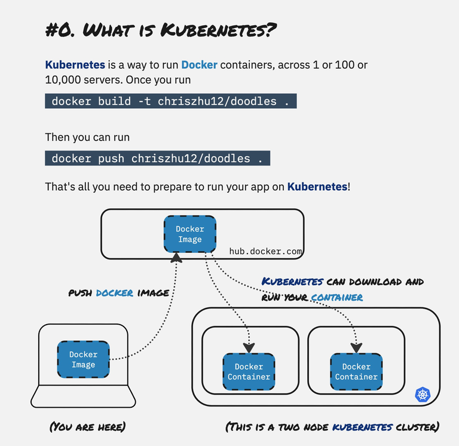
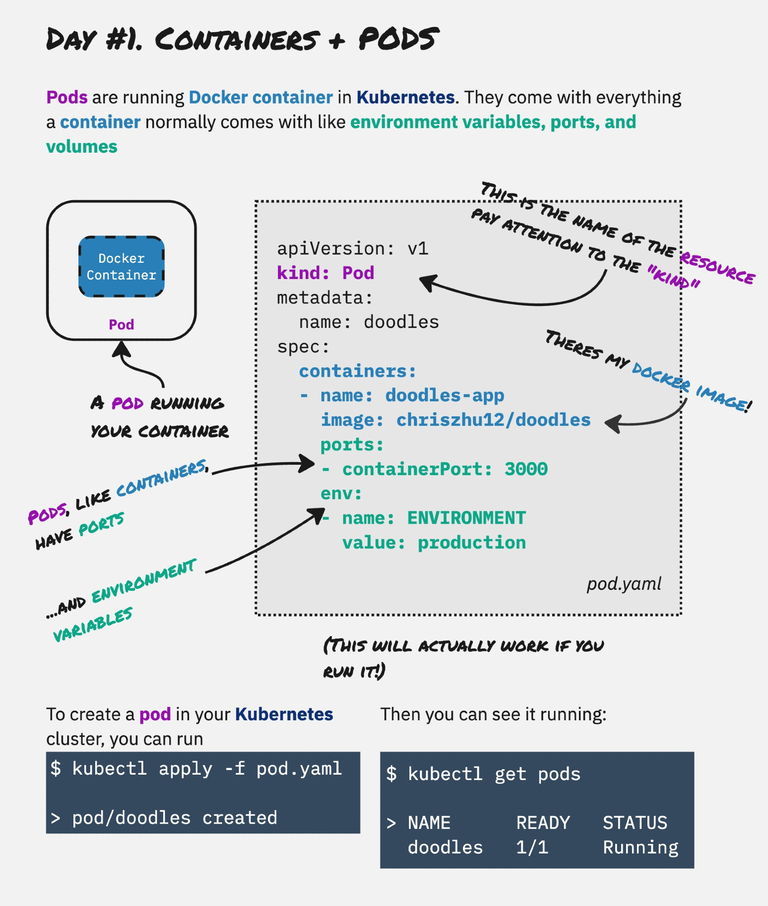
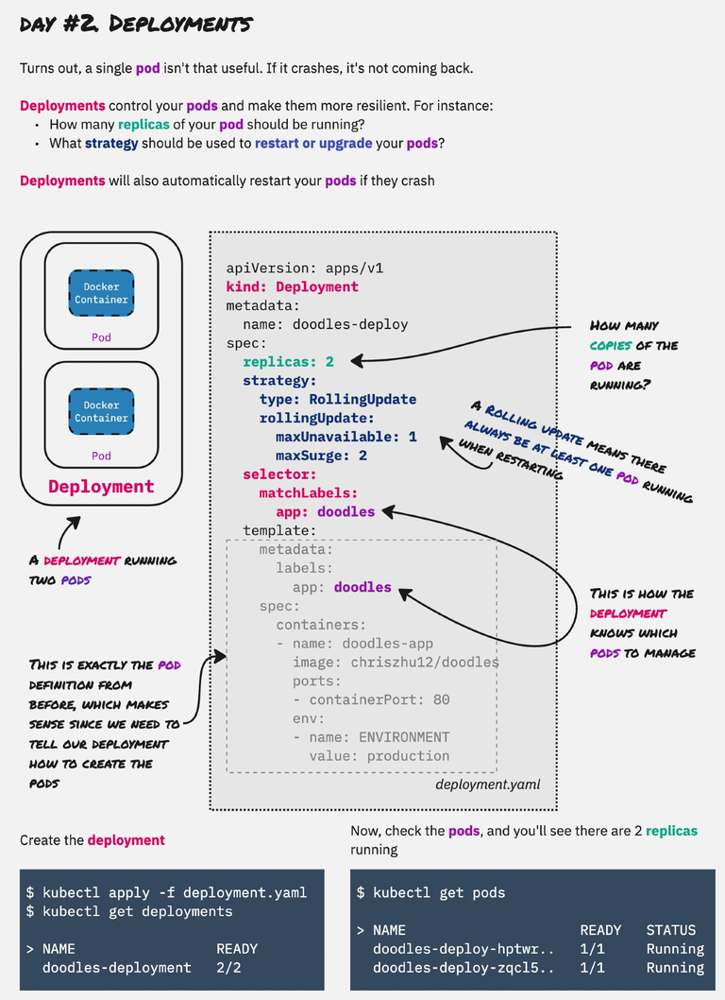
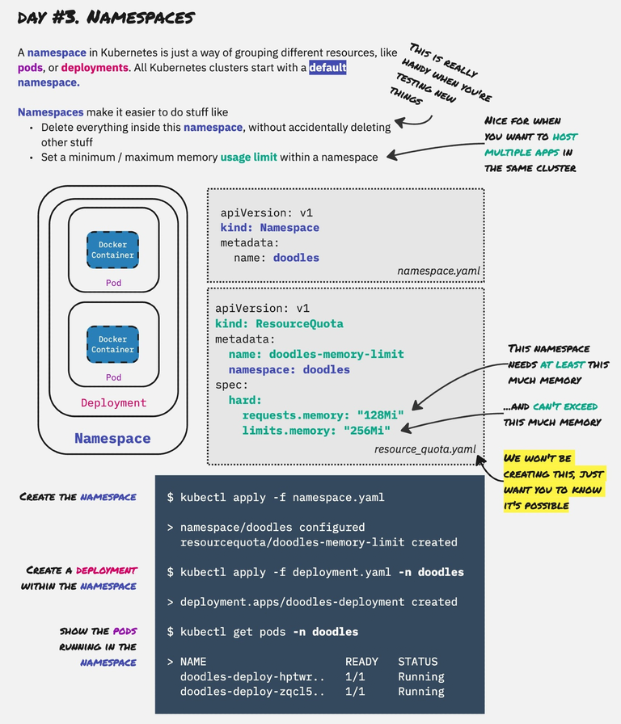

[Canine](https://github.com/CanineHQ/canine) is built on top of Kubernetes, and when I started writing its docs I wanted a way to explain Kubernetes that didn't start with a 40-page glossary. So I drew it instead.

This is the whole crash course: six drawings, each building on the last. Every YAML file in them is real. Apply them in order to a cluster that has an ingress controller installed, and you end up with an app on the internet.

## What is Kubernetes?

If you can build a Docker image and push it somewhere, you already have everything Kubernetes needs to run your app.



## Containers and pods

A pod is the smallest thing Kubernetes runs: your container, plus the ports, environment variables, and volumes it needs.



<details>
<summary>Copy the YAML</summary>

```yaml
# pod.yaml
apiVersion: v1
kind: Pod
metadata:
  name: doodles
spec:
  containers:
  - name: doodles-app
    image: chriszhu12/doodles
    ports:
    - containerPort: 3000
    env:
    - name: ENVIRONMENT
      value: production
```

```bash
kubectl apply -f pod.yaml
kubectl get pods
```

</details>

## Deployments

A single pod isn't very useful: if it crashes, it stays dead. A deployment keeps a set number of copies running, restarts them when they fail, and decides how to roll out a new version.



<details>
<summary>Copy the YAML</summary>

```yaml
# deployment.yaml
apiVersion: apps/v1
kind: Deployment
metadata:
  name: doodles-deploy
spec:
  replicas: 2
  strategy:
    type: RollingUpdate
    rollingUpdate:
      maxUnavailable: 1
      maxSurge: 2
  selector:
    matchLabels:
      app: doodles
  template:
    metadata:
      labels:
        app: doodles
    spec:
      containers:
      - name: doodles-app
        image: chriszhu12/doodles
        ports:
        - containerPort: 3000
        env:
        - name: ENVIRONMENT
          value: production
```

```bash
kubectl apply -f deployment.yaml
kubectl get deployments
kubectl get pods
```

</details>

## Namespaces

Namespaces group resources together. They're how you host several apps in one cluster without them stepping on each other, and how you clean up everything from an experiment in one command.



<details>
<summary>Copy the YAML</summary>

```yaml
# namespace.yaml
apiVersion: v1
kind: Namespace
metadata:
  name: doodles
```

```yaml
# resource_quota.yaml (optional)
apiVersion: v1
kind: ResourceQuota
metadata:
  name: doodles-memory-limit
  namespace: doodles
spec:
  hard:
    requests.memory: "128Mi"
    limits.memory: "256Mi"
```

```bash
kubectl apply -f namespace.yaml
kubectl apply -f deployment.yaml -n doodles
kubectl get pods -n doodles
```

</details>

## Services

A service gives a group of pods one stable address and spreads traffic across them. A `ClusterIP` service is only reachable from inside the cluster. A `NodePort` service is also reachable from the internet.


<details>
<summary>Copy the YAML</summary>

```yaml
# service.yaml
apiVersion: v1
kind: Service
metadata:
  name: doodles-service
  namespace: doodles
spec:
  type: ClusterIP # or, NodePort
  selector:
    app: doodles
  ports:
  - protocol: TCP
    targetPort: 3000
    port: 80
    name: http
```

```bash
kubectl apply -f service.yaml
kubectl -n doodles get services
```

</details>

## Ingress

An ingress is how you normally put a service on the internet. It routes traffic by hostname, so one cluster can serve `app.mysite.com` and `blog.mysite.com`, and it can take care of SSL certificates too.


<details>
<summary>Copy the YAML</summary>

```yaml
# ingress.yaml
apiVersion: networking.k8s.io/v1
kind: Ingress
metadata:
  name: doodles-ingress
  namespace: doodles
spec:
  rules:
  - host: app.mysite.com
    http:
      paths:
      - path: /
        pathType: Prefix
        backend:
          service:
            name: doodles-service
            port:
              number: 80
```

</details>

## Putting it together

Stack the drawings and you get the whole picture: an ingress routes a hostname to a service, the service balances traffic across pods, a deployment keeps those pods alive, and a namespace holds it all together.

That's five YAML files for one app, before you've added a database, background workers, SSL, or a way to redeploy on every push. Writing all of that by hand gets old fast, and it's exactly what [Canine](https://canine.sh) does for you. It creates these resources on your own cluster so you get a Heroku-style experience without giving up control.

These drawings also live in the [Canine docs](https://docs.canine.sh/docs/technical-details/kubernetes-crash-course/).
